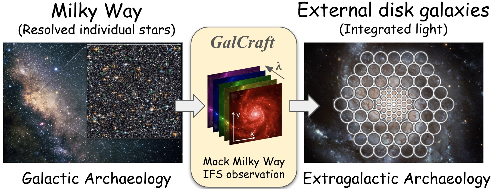

# Overview

## How it works

GalCraft assigns simple stellar population (SSP) spectra to stellar particles according to their ages, metallicities and α-element abundances, shifts and scales the spectra using particle velocities and distances (with optional extinction), and combines their light into spatially resolved mock IFS spectra.

The resulting mock IFS data cubes can be analysed using the same techniques commonly applied to real IFS observations, including but not limited to:

- **Voronoi binning** ([Cappellari & Copin 2003](https://ui.adsabs.harvard.edu/abs/2003MNRAS.342..345C/abstract)).
- **Penalized Pixel-Fitting (pPXF)** ([Cappellari & Emsellem 2004](https://ui.adsabs.harvard.edu/abs/2004PASP..116..138C/abstract); [Cappellari 2017](https://ui.adsabs.harvard.edu/abs/2017MNRAS.466..798C/abstract), [2023](https://ui.adsabs.harvard.edu/abs/2023MNRAS.526.3273C/abstract)).
- **Absorption-line strength indices** (e.g., [Worthey 1994](https://ui.adsabs.harvard.edu/abs/1994ApJS...95..107W/abstract); [Schiavon 2007](https://ui.adsabs.harvard.edu/abs/2007ApJS..171..146S/abstract); [Thomas et al. 2011](https://ui.adsabs.harvard.edu/abs/2011MNRAS.412.2183T/abstract); [Martín-Navarro et al. 2018](https://ui.adsabs.harvard.edu/abs/2018MNRAS.475.3700M/abstract)).
- **Integrated IFS analysis pipelines**, such as GIST ([Bittner et al. 2019](https://ui.adsabs.harvard.edu/abs/2019A%26A...628A.117B/abstract)) and nGIST ([Fraser-McKelvie et al. 2025](https://ui.adsabs.harvard.edu/abs/2025ascl.soft07015F/abstract)), which combine multiple analysis techniques.

By bridging stellar-particle simulations and observational IFS data, **GalCraft enables direct, like-for-like comparisons between models of the Milky Way or simulated galaxies and external galaxies observed with IFS instruments**, providing a framework for testing spectral analysis methods and investigating galaxy formation and evolution.
