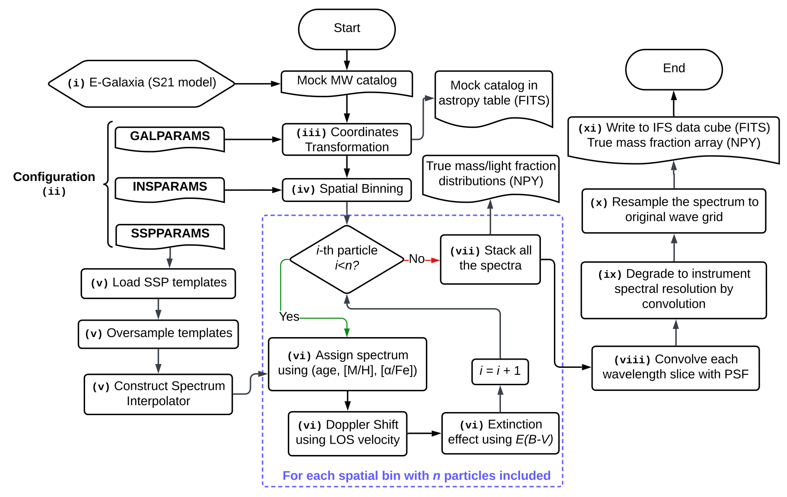

# Workflow

*GalCraft flowchart from [Wang et al. (2024)](https://doi.org/10.1093/mnras/stae2148)*

The following stages follow the procedure in [Wang et al. (2024)](https://doi.org/10.1093/mnras/stae2148) and the implementation in the current GalCraft source supplied with this repository. The associated source modules are listed in [Modules](../modules.md).

## 1. Load the stellar particle catalog and configuration

Supply a stellar-particle catalogue containing positions, velocities, stellar ages, metallicities and α-element abundances, plus optional extinction values. The setup file defines observer geometry, instrument/spatial binning, SSP-template selection and run-time options. In the current command-line implementation, the catalogue is loaded with `ebf.read()` (EBF format); a simulation initially supplied as FITS requires preprocessing or a reader modification.

## 2. Transform to the observer frame

For a galaxy model not already expressed in the observer frame, `Cot.observe()` transforms particle positions and velocities using observer parameters (distance, sky position and rotation angles). 

## 3. Bin particles into spatial pixels

`Binner.spatial_binner()` selects particles within each requested field of view, assigns them to spaxels and records particle-count information. Users may generate several cubes from a list of pointing centres.

## 4. Load and oversample SSP templates

`SSPLoader.model` loads the chosen SSP library, identifies its age, metallicity and α-abundance grid and prepares an oversampled wavelength grid. Oversampling improves the numerical accuracy of Doppler shifting and instrumental spectral convolution, especially when the broadening kernel would otherwise be narrower than a native template wavelength bin.

The original paper demonstrates that oversampling substantially reduces differences between spectra stacked from discrete velocity-shifted particles and reference broadened spectra (approximately a factor of 25 in the example shown there).

## 5. Assign and combine individual stellar spectra

Within each spaxel, `SpecGeneratorPix` interpolates or selects SSP spectra according to stellar population parameters. Each particle contributes a mass-scaled spectrum with distance scaling; then, GalCraft applies a Doppler shift from the line-of-sight velocity and attenuation based on `E(B−V)` (optional). Contributions are summed to form the spaxel's integrated spectrum, and the associated SSP-population weights are accumulated.

The multi-process dispatcher in `SpecGenerator` repeats this calculation for non-empty spaxels and assembles their spectra into a cube.

## 6. Match the spectral resolution and resample

The integrated spectra are broadened to the specified spectral line-spread function (LSF) and resampled onto the requested wavelength grid or range. The target spectral resolution must not be finer than what the native SSP templates permit.

## 7. Write IFS cubes and diagnostic products

`CubeMaker.write_cube()` writes the FITS cube and wavelength axis, optionally adding simulated Gaussian noise. GalCraft also saves SSP-weight arrays, particle counts, visual diagnostic plots, effective run configuration and log information.

## Spatial PSF and spectral resolution

The published flowchart places **spatial PSF convolution** between spectrum stacking and spectral-resolution degradation; the paper describes Gaussian or Moffat kernels. However, the archived source examined here does not expose an active spatial PSF convolution in its main workflow. By contrast, **spectral** resolution matching is implemented in `SSPLoader` / `SpecGeneratorPix` using LSF broadening. Do not assume that the generated cubes include a spatial seeing model without verifying the version you run.

## Batch execution and continuation

With `instrument: DIY` or a named instrument preset, supply a `setup_NAME_list` file with one comma-separated coordinate pair per line. GalCraft can generate multiple pointed cubes in one run. `other_params.mode: continue` reuses saved intermediate tables and skips cubes already present, provided the earlier run retained the required files.
